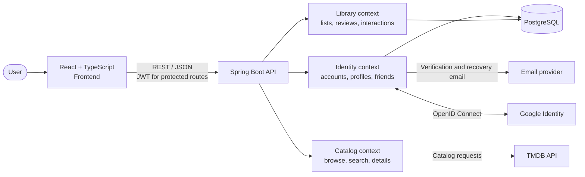

<div align="center">

# 🎬 CorsaBox

**Your diary of movies, series and anime.**  
Log what you've watched, save what you want to watch, and share reviews with the community.

[](https://www.corsabox.app)


[**Live app**](https://www.corsabox.app) · [**Report a bug**](../../issues)

</div>

---

## About

CorsaBox is a catalog and personal diary for movies, series and anime. Browse titles, keep track of what you have watched, and organize what you want to watch. Publish reviews, discover other viewers, and personalize your public profile. The project has a React single-page frontend and a Java/Spring Boot REST API.

### Features

- **Google sign-in:** sign up or log in with Google, choose a username on your first visit, and link an existing account after confirming its current password.
- **Account and profile:** register with email verification, edit your name and username, and manage your account. Accounts with a local password support password changes and recovery; Google-only accounts sign in without a CorsaBox password.
- **Catalog:** browse trending titles and movies now playing in Brazil, filter movies, series and anime by genre, search the TMDB catalog, and view title, season and episode details.
- **Where to watch:** check streaming, rental and purchase availability in Brazil.
- **Personal library:** maintain watchlist, watched and currently watching lists.
- **Viewing diary:** rate and review watched titles, record viewing dates, and track watched episodes by series and season.
- **Community feed:** choose which reviews to publish, react to reviews and comments with likes or dislikes, and control whether your reviews accept comments.
- **Friends:** find people, send and manage friend requests, and visit their profiles.
- **Public profiles:** customize your photo and bio, showcase favorite movies, series and anime, and display your published reviews. Profile pages require sign-in.
- **Responsive experience:** landing page and app layouts for desktop and mobile, with paginated/infinite catalog and library browsing.

## Tech stack

**Backend:** Java 25, Spring Boot 4.1, Spring Security (JWT and Google OpenID Connect), Spring Data JPA, PostgreSQL 17, TMDB API, springdoc-openapi, Maven.

**Frontend:** React 19, TypeScript, Vite, Tailwind CSS 4, React Router, React Hook Form, Zod and lucide-react.

**Supporting services:** Brevo for transactional email; Docker Compose for local PostgreSQL.

## Architecture

The frontend calls the REST API. The API separates identity, catalog and library responsibilities: identity handles accounts and authentication, catalog retrieves media data from TMDB, and library stores each user's lists, viewing history, published reviews and review interactions in PostgreSQL. Identity also manages friendships and public profile customization. Google sign-in uses OpenID Connect validated by the backend, then opens the same CorsaBox JWT and refresh-token session used by password login. Email adapters deliver verification and password recovery messages.



### Project layout

```text
corsabox/
├── src/main/java/com/corsini/corsabox/
│   ├── config/                 # Application-wide security configuration
│   ├── identity/               # Accounts, authentication, public profiles, friendships and email
│   │   ├── api/                # Controllers, requests, responses and exception handling
│   │   ├── application/        # Use cases, DTOs and ports
│   │   ├── domain/             # Identity entities, repositories and domain rules
│   │   └── infrastructure/     # Persistence, JWT, mail, rate limiting and scheduling
│   ├── catalog/                # TMDB-backed catalog, search and title/season details
│   │   ├── api/
│   │   ├── application/
│   │   ├── domain/
│   │   └── infrastructure/
│   └── library/                # Lists, episode progress, review feed and interactions
│       ├── api/
│       ├── application/
│       ├── domain/
│       └── infrastructure/
├── src/main/resources/         # Spring configuration
├── src/test/                   # Backend tests
├── frontend/
│   ├── public/                 # Static assets, posters and SEO files
│   └── src/
│       ├── auth/               # Authentication context and route guards
│       ├── components/         # Shared UI and feature components
│       ├── lib/                # API client, catalog/library helpers and hooks
│       └── pages/              # Landing, catalog, library, feed, friends and profile pages
├── compose.yaml                # Local PostgreSQL service
├── Dockerfile
└── pom.xml
```

The backend contexts follow a layered structure: domain rules stay independent of Spring Data, application use cases depend on ports, and infrastructure provides persistence and external-service adapters.

## Running locally

### Prerequisites

| Tool | Version |
|---|---|
| JDK | 25 |
| Node.js | 22.22 or newer |
| Docker with Compose | Recent version |

### 1. Clone the repository

```bash
git clone https://github.com/pedrocorsini/corsabox.git
cd corsabox
```

### 2. Start PostgreSQL

```bash
docker compose up -d
```

The API can also start the database through Spring Boot's Docker Compose integration in the default development profile.

### 3. Run the API

Set `TMDB_TOKEN` to your TMDB API Read Access Token in the same terminal before starting the API:

```bash
export TMDB_TOKEN='your-tmdb-read-access-token'
```

In PowerShell, use `$env:TMDB_TOKEN = 'your-tmdb-read-access-token'` instead.

```bash
./mvnw spring-boot:run
```

On Windows, run `mvnw.cmd spring-boot:run`. The API is available at **http://localhost:8080**. Swagger UI is at `/swagger-ui.html` and the health check is at `/actuator/health`.

Without the `prod` profile, verification codes and password reset links are printed in the API terminal instead of being emailed. Use them to complete registration and password recovery locally; Brevo credentials are not needed. Reset links use `APP_FRONTEND_URL`, which defaults to `http://localhost:5173`. These logs contain temporary credentials and should remain local. The `prod` profile uses Brevo instead.

### 4. Run the frontend

In another terminal:

```bash
cd frontend
npm install
npm run dev
```

Open **http://localhost:5173**. In development, Vite proxies API requests to the local backend.

### 5. Enable Google sign-in (optional)

Create a Web application OAuth client in Google Cloud and register `http://localhost:8080/login/oauth2/code/google` as an authorized redirect URI. Set `GOOGLE_LOGIN_ENABLED=true`, `GOOGLE_CLIENT_ID`, and `GOOGLE_CLIENT_SECRET` in the backend environment before starting the API. The Google button appears on the login and registration pages when enabled.

See [Google sign-in configuration](docs/google-login.md) for the complete setup, production URLs, cookie requirements, and verification steps. Keep the client secret on the backend. Google sign-in is disabled by default; email/password authentication remains available.

## Environment variables

Set backend variables in the shell or hosting environment before starting the API. `TMDB_TOKEN` enables catalog requests; `APP_JWT_SECRET` and `APP_VERIFICATION_SECRET` should be set to private, strong values outside local development. Email delivery uses `MAIL_API_KEY` and `MAIL_SENDER_EMAIL`; production database credentials are provided with `SPRING_DATASOURCE_USERNAME` and `SPRING_DATASOURCE_PASSWORD`. The frontend optionally reads `VITE_API_URL` from `frontend/.env.local` to set the API base URL; leave it unset for the local Vite proxy.
Additional deployment settings:

| Variable | Purpose |
|---|---|
| `SPRING_PROFILES_ACTIVE` | Set to `prod` to use Brevo and production database settings and disable Docker Compose integration. |
| `SPRING_DATASOURCE_URL` | Override the JDBC URL; the `prod` profile otherwise uses the hosted URL in `application-prod.properties`. |
| `APP_FRONTEND_URL` | Exact frontend origin for password reset links, Google sign-in returns and completion requests; defaults to `http://localhost:5173`. |
| `APP_CORS_ALLOWED_ORIGINS` | Comma-separated allowed frontend origins; defaults to `http://localhost:5173`. |
| `PORT` | API port; defaults to `8080`. |
| `REFRESH_COOKIE_SECURE`, `REFRESH_COOKIE_SAMESITE` | Cookie settings; defaults are `false` and `Lax`. The `prod` profile sets secure cookies to `true`. |
| `GOOGLE_LOGIN_ENABLED` | Enable Google sign-in with `true`; defaults to `false`. |
| `GOOGLE_CLIENT_ID`, `GOOGLE_CLIENT_SECRET` | Web application OAuth client credentials, configured only on the backend. |
| `GOOGLE_REDIRECT_URI` | Exact authorized Google callback URL; defaults to `http://localhost:8080/login/oauth2/code/google`. With the Vercel proxy, use the frontend HTTPS origin plus `/login/oauth2/code/google` so OAuth keeps the same session cookie. |
| `GOOGLE_SESSION_SAMESITE` | Production OAuth session cookie SameSite policy; defaults to `lax`. See the Google setup guide for deployments across different sites. |

`VITE_API_URL` is embedded at build time. Never put secrets in frontend environment variables.

## API overview

Episode reviews are written from the episode's **Detalhes** form. Publishing to the feed is optional, with the same comment and reaction controls as title reviews. Existing episode reviews stay private.

Before deploying this feature to an existing PostgreSQL database, stop application writes and run [`enable-episode-reviews.sql`](src/main/resources/db/maintenance/enable-episode-reviews.sql). The script preserves existing records and updates the interaction constraints that Hibernate `ddl-auto=update` cannot replace. Fresh databases use the entity mappings directly. The script includes rollback guidance; Flyway remains disabled.

The REST API provides endpoints for account registration and authentication, profile management, people search and friendships, catalog browsing and search, each user's media library, and the community review feed. Trending and now-playing catalog endpoints are public; other catalog endpoints require authentication. Catalog data comes from TMDB; authenticated library endpoints use the JWT to scope watchlists, viewing records, ratings, reviews and episode progress to the current user. Feed, profile and friendship endpoints also require authentication; publishing a review makes it visible to other signed-in users. See Swagger UI for the full endpoint reference.

## Branch workflow and contributing

- `main` is the stable branch for releases.
- `dev` is the integration branch for ongoing development.
- Create short-lived branches from `dev`, using names such as `feat/my-feature`, `fix/my-fix` or `docs/readme-update`.

```bash
git switch dev
git pull --ff-only origin dev
git switch -c feat/my-feature
```

1. Implement the change and review the diff. Keep credentials and local environment files out of commits.
2. Validate in proportion to the change: documentation-only changes need a content and diff review; behavior changes need focused checks for the affected behavior.
3. Before opening a pull request, run the relevant backend tests (`./mvnw test`, or `mvnw.cmd test` on Windows) and frontend checks (`npm run lint` and `npm run build` from `frontend`) for the affected areas. Reuse successful results when the relevant code and dependencies have not changed.
4. Use a short Conventional Commit message, such as `feat: add library controls`, and open a pull request into `dev` explaining what changed and why. Include screenshots for visible frontend changes.
5. Promote reviewed changes from `dev` to `main` through a release pull request. Delete completed feature branches after their changes are integrated.

When using a coding agent, finish and review the result before explicitly authorizing commits or pull requests. Pushes, merges and deployments also require authorization for the current change, as described in [AGENTS.md](AGENTS.md).

## Credits

This product uses the TMDB API but is not endorsed or certified by TMDB.

Watch availability data is provided by JustWatch through TMDB.

## License

This project is licensed under the [MIT License](LICENSE).

© 2026 Pedro Corsini
