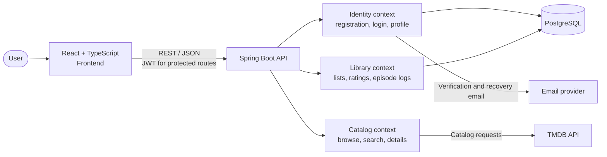

<div align="center">

# 🎬 CorsaBox

**Your diary of movies, series and anime.**  
Log what you've watched and save what you want to watch.

[](https://www.corsabox.app)


[**Live app**](https://www.corsabox.app) · [**Report a bug**](../../issues)

</div>

---

## About

CorsaBox is a catalog and personal diary for movies, series and anime. Browse titles, keep track of what you have watched, and organize what you want to watch. The project has a React single-page frontend and a Java/Spring Boot REST API.

### Features

- **Account and profile:** register with email verification, log in, edit your profile, change your password, and recover access.
- **Catalog:** browse trending titles, filter movies, series and anime, search the TMDB catalog, and view title, season and episode details.
- **Personal library:** maintain watchlist, watched and currently watching lists.
- **Viewing diary:** rate and review watched titles, record viewing dates, and track watched episodes by series and season.
- **Responsive experience:** landing page and app layouts for desktop and mobile, with paginated/infinite catalog and library browsing.

## Tech stack

**Backend:** Java 25, Spring Boot 4.1, Spring Security (JWT), Spring Data JPA, PostgreSQL 17, TMDB API, springdoc-openapi, Maven.

**Frontend:** React 19, TypeScript, Vite, Tailwind CSS 4, React Router, React Hook Form, Zod and lucide-react.

**Supporting services:** Brevo for transactional email; Docker Compose for local PostgreSQL.

## Architecture

The frontend calls the REST API. The API separates identity, catalog and library responsibilities: identity handles accounts and authentication, catalog retrieves media data from TMDB, and library stores each user's lists and viewing history in PostgreSQL. Email adapters deliver verification and password recovery messages.



### Project layout

```text
corsabox/
├── src/main/java/com/corsini/corsabox/
│   ├── config/                 # Application-wide security configuration
│   ├── identity/               # Registration, authentication, profiles and email flows
│   │   ├── api/                # Controllers, requests, responses and exception handling
│   │   ├── application/        # Use cases, DTOs and ports
│   │   ├── domain/             # Identity entities, repositories and domain rules
│   │   └── infrastructure/     # Persistence, JWT, mail, rate limiting and scheduling
│   ├── catalog/                # TMDB-backed catalog, search and title/season details
│   │   ├── api/
│   │   ├── application/
│   │   ├── domain/
│   │   └── infrastructure/
│   └── library/                # Watchlists, watched titles and episode progress
│       ├── api/
│       ├── application/
│       ├── domain/
│       └── infrastructure/
├── src/main/resources/         # Spring configuration
├── src/test/                   # Backend tests
├── frontend/
│   ├── public/                 # Static assets, posters and SEO files
│   └── src/
│       ├── auth/               # Authentication context and route guards
│       ├── components/         # Shared UI and feature components
│       ├── lib/                # API client, catalog/library helpers and hooks
│       └── pages/              # Landing, catalog, title, library and account pages
├── compose.yaml                # Local PostgreSQL service
├── Dockerfile
└── pom.xml
```

The backend contexts follow a layered structure: domain rules stay independent of Spring Data, application use cases depend on ports, and infrastructure provides persistence and external-service adapters.

## Running locally

### Prerequisites

| Tool | Version |
|---|---|
| JDK | 25 |
| Node.js | 22.22 or newer |
| Docker with Compose | Recent version |

### 1. Clone the repository

```bash
git clone https://github.com/pedrocorsini/corsabox.git
cd corsabox
```

### 2. Start PostgreSQL

```bash
docker compose up -d
```

The API can also start the database through Spring Boot's Docker Compose integration in the default development profile.

### 3. Run the API

```bash
./mvnw spring-boot:run
```

On Windows, run `mvnw.cmd spring-boot:run`. The API is available at **http://localhost:8080**. Swagger UI is at `/swagger-ui.html` and the health check is at `/actuator/health`.

### 4. Run the frontend

In another terminal:

```bash
cd frontend
npm install
npm run dev
```

Open **http://localhost:5173**. In development, Vite proxies API requests to the local backend.

## Environment variables

Set backend variables in the shell or hosting environment before starting the API. `TMDB_TOKEN` enables catalog requests; `APP_JWT_SECRET` and `APP_VERIFICATION_SECRET` should be set to private, strong values outside local development. Email delivery uses `MAIL_API_KEY` and `MAIL_SENDER_EMAIL`; production database credentials are provided with `SPRING_DATASOURCE_USERNAME` and `SPRING_DATASOURCE_PASSWORD`. The frontend optionally reads `VITE_API_URL` from `frontend/.env.local` to set the API base URL; leave it unset for the local Vite proxy.
## API overview

The REST API provides endpoints for account registration and authentication, profile management, catalog browsing and search, and each user's media library. Public catalog endpoints retrieve title data from TMDB; authenticated library endpoints use the JWT to scope watchlists, viewing records, ratings, reviews and episode progress to the current user. See Swagger UI for the full endpoint reference.

## Contributing

1. Fork the repository and create a branch: `git checkout -b feature/my-feature`.
2. Commit your changes with a clear message.
3. Run `./mvnw test` and `npm run lint` before opening a pull request.
4. Open a pull request describing what changed and why.

## Credits

This product uses the TMDB API but is not endorsed or certified by TMDB.

© 2026 CorsaBox
