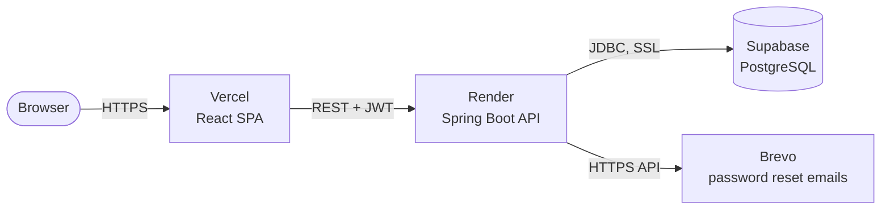

<div align="center">

# 🎬 CorsaBox

**Your diary of movies, series and anime.**
Log what you've watched. Save what you want to watch.

[](https://www.corsabox.app/)


[**Live app**](https://www.corsabox.app/) · [**API docs (Swagger)**](https://corsabox.onrender.com/swagger-ui.html) · [**Report a bug**](../../issues)

</div>

---

## About

CorsaBox is a Letterboxd-style catalog for movies, series and anime. It is a full-stack project: a **REST API** built with Java and Spring Boot, and a **single-page frontend** built with React.

The backend is organised with **Domain-Driven Design**, starting with the `identity` context (everything about users and authentication).

> **Status: under construction.** Sign up, login, profile management and password recovery work today. The TMDB-powered catalog and the watched/watchlist lists are next.

### Features

| | Feature | Status |
|---|---|---|
| ✅ | Sign up with email and password | Done |
| ✅ | Login with JWT (stateless) | Done |
| ✅ | List registered users (paginated) | Done |
| ✅ | Profile page: update name and username | Done |
| ✅ | Change password while logged in | Done |
| ✅ | "Forgot my password" flow (single-use, expiring token sent by email) | Done |
| ✅ | Public landing page and responsive UI | Done |
| 🚧 | Search movies, series and anime (TMDB) | Next |
| 🚧 | CRUD for the *watched* list and the *watchlist* | Planned |
| 🚧 | Login with Google | Planned |

---

## Tech stack

**Backend**
- Java 25, Spring Boot 4.1 (Web MVC, Data JPA, Validation, Actuator, Cache)
- Spring Security with the OAuth2 Resource Server (HS256 JWT)
- PostgreSQL 17 (Hibernate with `ddl-auto=update`)
- springdoc-openapi (Swagger UI)
- Lombok, Maven Wrapper

**Frontend**
- React 19, TypeScript, Vite
- Tailwind CSS 4
- React Router, React Hook Form + Zod
- lucide-react icons

**Infrastructure**
- Frontend on **Vercel**, API on **Render**, database on **Supabase** (all on free plans)
- Transactional email through **Brevo** (production only)
- Docker for the local database and for the API image

---

## Architecture



### Backend layout

```
src/main/java/com/corsini/corsabox/identity
├── api              # Controllers, request/response records, exception handler
├── application      # Use cases (services), commands and ports (interfaces)
├── domain           # User, UserId, PasswordResetToken, repositories, exceptions
└── infrastructure   # JPA persistence, JWT and security config, mail adapters
```

The domain layer has no dependency on Spring Data. The application layer talks to the outside world through **ports** (`TokenIssuer`, `PasswordResetMailer`, `ResetTokenService`), and the infrastructure layer provides the adapters.

---

## Running locally

### Prerequisites

| Tool | Version |
|---|---|
| JDK | 25 |
| Node.js | 22.22 or newer |
| Docker (with Compose) | any recent version |

### 1. Clone the repository

```bash
git clone https://github.com/pedrocorsini/corsabox.git
cd corsabox
```

### 2. Start the database

The project ships with a `compose.yaml` for PostgreSQL 17.

```bash
docker compose up -d
```

> You can skip this step: with `spring-boot-docker-compose` on the classpath, the API starts the database for you when it boots in the default (non-prod) profile. Running it manually is useful if you want the database up before the API.

The default credentials are `corsabox` / `corsabox` on port `5432`. To change the password, set `DB_PASSWORD` before starting Compose.

### 3. Run the API

```bash
./mvnw spring-boot:run
```

On Windows, use `mvnw.cmd spring-boot:run`.

The API is now available at **http://localhost:8080**.

- Swagger UI: http://localhost:8080/swagger-ui.html
- Health check: http://localhost:8080/actuator/health

Tables are created automatically on first run.

### 4. Run the frontend

In a second terminal:

```bash
cd frontend
npm install
npm run dev
```

Open **http://localhost:5173**. The Vite dev server proxies every `/api` request to `http://localhost:8080`, so no extra configuration is needed.

### 5. Try it out

1. Go to http://localhost:5173 and click **Criar conta** (Create account).
2. Sign up, and you will be logged in automatically and sent to the catalog page.
3. Open your profile to edit your name, username and password.

**Testing "forgot my password" locally:** outside the `prod` profile no email is sent. Instead, the API prints the reset link in the console:

```
Link de redefinição para you@example.com: http://localhost:5173/redefinir-senha?token=...
```

Copy that link into the browser to finish the flow.

### Useful commands

```bash
./mvnw test                   # backend tests (needs the database running)
./mvnw -DskipTests package    # build the JAR into target/

cd frontend
npm run lint                  # ESLint
npm run build                 # type-check and production build
npm run preview               # serve the production build locally
```

---

## Configuration

### Backend environment variables

| Variable | Default | Description |
|---|---|---|
| `JWT_SECRET` | dev-only key | Secret used to sign JWTs. **Must be changed in production** (at least 32 bytes). |
| `APP_CORS_ALLOWED_ORIGINS` | `http://localhost:5173` | Comma-separated list of allowed frontend origins. |
| `APP_FRONTEND_URL` | `http://localhost:5173` | Used to build the links in password reset emails. |
| `PORT` | `8080` | HTTP port (Render sets this for you). |
| `SPRING_PROFILES_ACTIVE` | none | Set to `prod` in production. |
| `SPRING_DATASOURCE_USERNAME` | none | Database user (`prod` profile). |
| `SPRING_DATASOURCE_PASSWORD` | none | Database password (`prod` profile). |
| `MAIL_API_KEY` | none | Brevo API key (`prod` profile). |
| `MAIL_SENDER_EMAIL` | none | Verified sender address in Brevo (`prod` profile). |

### Frontend environment variables

| Variable | Default | Description |
|---|---|---|
| `VITE_API_URL` | empty | Base URL of the API. Empty in development (the Vite proxy is used). Set it to the Render URL in production. |

---

## API overview

The full, interactive reference lives in Swagger UI. Here is the summary:

| Method | Endpoint | Auth | Description |
|---|---|---|---|
| `POST` | `/api/users` | Public | Create an account |
| `POST` | `/api/auth/login` | Public | Log in and receive a JWT |
| `POST` | `/api/auth/forgot-password` | Public | Request a reset link (always returns `202`) |
| `POST` | `/api/auth/reset-password` | Public | Set a new password using the token |
| `GET` | `/api/users` | JWT | List users (`page`, `size`, max 100) |
| `GET` | `/api/users/me` | JWT | Current user |
| `PATCH` | `/api/users/me` | JWT | Update `firstName`, `lastName` and/or `username` |
| `PUT` | `/api/users/me/password` | JWT | Change password |

Authenticated requests send the token in the header: `Authorization: Bearer <token>`. Tokens are valid for 1 hour. Errors follow the RFC 9457 *Problem Details* format.

**Example:**

```bash
# Sign up
curl -X POST http://localhost:8080/api/users \
  -H "Content-Type: application/json" \
  -d '{"firstName":"Ada","lastName":"Lovelace","username":"ada","email":"ada@example.com","password":"supersecret"}'

# Log in
curl -X POST http://localhost:8080/api/auth/login \
  -H "Content-Type: application/json" \
  -d '{"email":"ada@example.com","password":"supersecret"}'

# Who am I?
curl http://localhost:8080/api/users/me -H "Authorization: Bearer <accessToken>"
```

### Security notes

- Passwords are hashed with BCrypt.
- Password reset tokens are random 256-bit values. Only their **SHA-256 hash** is stored, they expire after 30 minutes, and each one can be consumed **only once** (atomic update).
- Requesting a new link invalidates the previous ones.
- `forgot-password` answers the same way whether the email exists or not, so it does not reveal who has an account.

---

## Deployment

The production setup uses three free-tier services. Deploy them in this order: **database → API → frontend**.

| Layer | Service | Live URL |
|---|---|---|
| Frontend | Vercel | https://YOUR-APP.vercel.app |
| API | Render | https://YOUR-API.onrender.com |
| Database | Supabase | private |

### 1. Database (Supabase)

1. Create a project on [Supabase](https://supabase.com).
2. In **Connect**, copy the **Session pooler** connection details (host, port `5432`, user and password).
3. Update the host in `src/main/resources/application-prod.properties` if yours differs from the one in the repository:

   ```properties
   spring.datasource.url=jdbc:postgresql://<your-pooler-host>:5432/postgres?sslmode=require
   ```

Tables are created by Hibernate (`ddl-auto=update`) the first time the API boots.

### 2. API (Render)

The API is deployed as a Docker web service using the `Dockerfile` in the repository root (a multi-stage build: JDK 25 to compile, JRE 25 to run).

1. On [Render](https://render.com), create a **New → Web Service** and connect the GitHub repository.
2. Set the runtime to **Docker**. The file in the repository is named `DOCKERFILE`; since Linux is case-sensitive, either rename it to `Dockerfile` or set **Dockerfile Path** to `./DOCKERFILE`.
3. Add the environment variables:

   | Variable | Value |
   |---|---|
   | `SPRING_PROFILES_ACTIVE` | `prod` |
   | `SPRING_DATASOURCE_USERNAME` | your Supabase user |
   | `SPRING_DATASOURCE_PASSWORD` | your Supabase password |
   | `JWT_SECRET` | a long random string (32+ bytes) |
   | `APP_CORS_ALLOWED_ORIGINS` | `https://YOUR-APP.vercel.app` |
   | `APP_FRONTEND_URL` | `https://YOUR-APP.vercel.app` |
   | `MAIL_API_KEY` | your Brevo API key |
   | `MAIL_SENDER_EMAIL` | your verified Brevo sender |

4. Set the health check path to `/actuator/health` and deploy.

The `prod` profile turns off the Docker Compose integration, points the API at Supabase over SSL, and replaces the console mailer with the Brevo mailer.

> **Free-tier note:** Render spins the service down when idle, so the first request after a pause can take a while. The frontend handles this: it keeps retrying with backoff instead of logging the user out, and only a real `401` ends the session.

### 3. Frontend (Vercel)

1. On [Vercel](https://vercel.com), import the repository.
2. Set **Root Directory** to `frontend`. Vite is detected automatically.
3. Add the environment variable:

   | Variable | Value |
   |---|---|
   | `VITE_API_URL` | `https://YOUR-API.onrender.com` |

4. Deploy. `frontend/vercel.json` rewrites every path to `index.html`, so client-side routes such as `/perfil` and `/redefinir-senha` work on refresh and when opened from an email link.

### 4. Email (Brevo)

Create a [Brevo](https://www.brevo.com) account, verify a sender address, generate an API key, and put both in the Render variables above. Without them, password reset emails are not delivered in production.

### Continuous deployment

Render and Vercel both redeploy automatically on every push to the main branch.

---

## Roadmap

- [ ] Backend for the TMDB catalog (search and details for movies, series and anime)
- [ ] Connect the catalog page and the landing page's "trending" strip to real data
- [ ] CRUD for watched titles and the watchlist
- [ ] Move a title from the watchlist to watched
- [ ] Login with Google
- [ ] Rate limiting on the password reset endpoints
- [ ] Revoke old JWTs after a password reset

---

## Contributing

1. Fork the repository and create a branch: `git checkout -b feature/my-feature`
2. Commit your changes with a clear message
3. Run `./mvnw test` and `npm run lint` before opening the pull request
4. Open a pull request describing what changed and why

---

## Credits

This product uses the TMDB API but is not endorsed or certified by TMDB.

© 2026 CorsaBox
